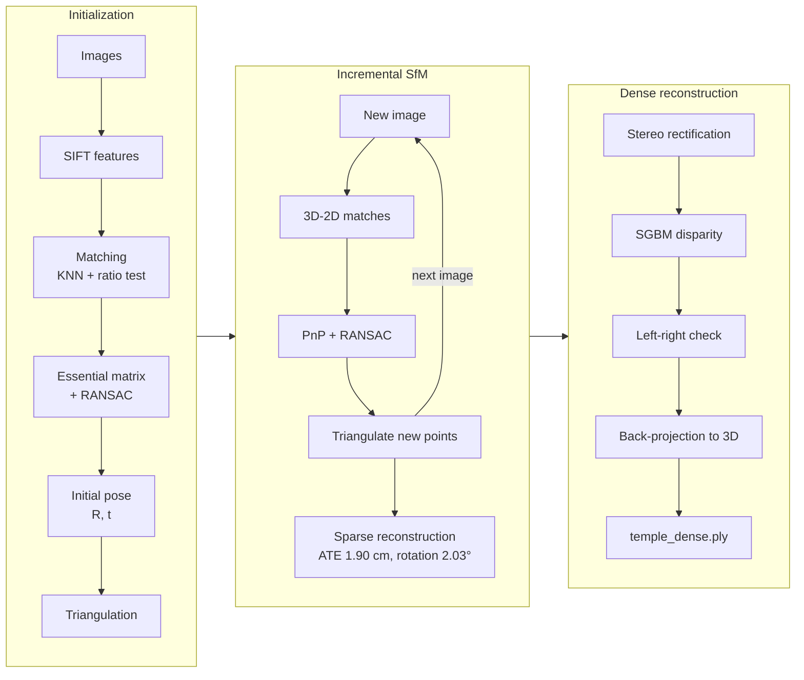
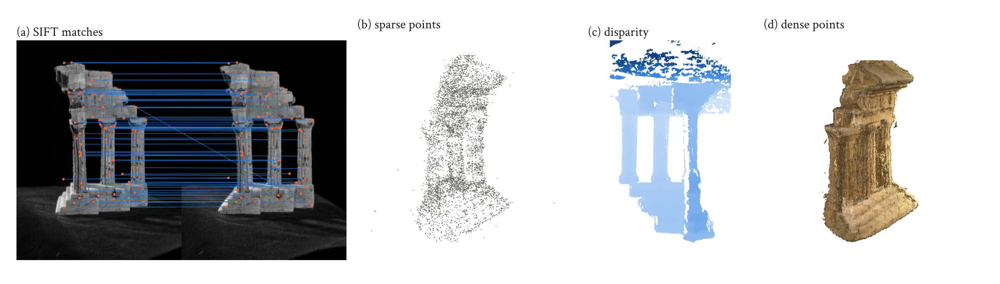
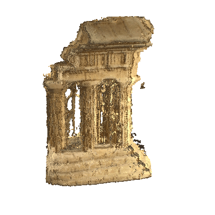

# 3D Structure from Motion


Incremental SfM on the [Middlebury TempleRing](https://vision.middlebury.edu/mview/data/) dataset (47 images) with Python and OpenCV. Camera poses are estimated with SIFT + PnP, then a dense point cloud is built with stereo matching between neighboring images.

## Pipeline





## Results

All 47 cameras are registered. The camera position error is 1.9 cm (RMSE) on a ring with a radius of about 55 cm. The dense cloud has about 1.8 M points.

<p>
  
  
</p>

ORB features were tried first, but the trajectory drifted by more than 1 m. Switching to SIFT fixed it.

## Run

```
pip install numpy opencv-python matplotlib
jupyter notebook sfm.ipynb
```

Download the TempleRing data into a `templeRing/` folder next to the notebook.
