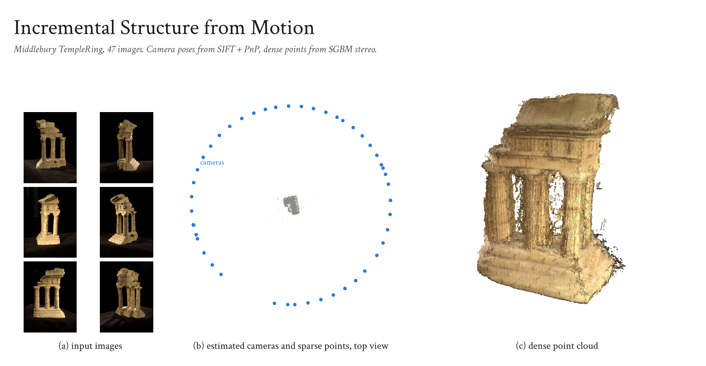
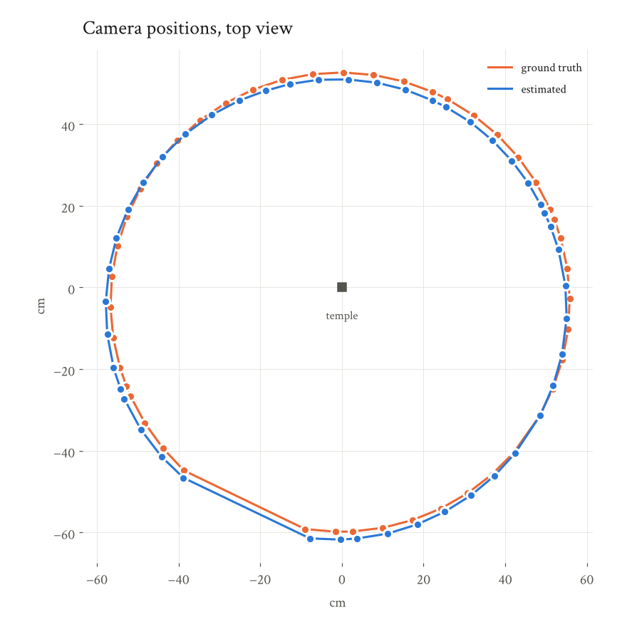

# 3D Structure from Motion

flowchart TD
    A[Images] --> B[Feature Detection<br/>SIFT]
    B --> C[Feature Matching<br/>KNN + Ratio Test]
    C --> D[Essential Matrix<br/>+ RANSAC]
    D --> E[Initial Camera Pose<br/>R, t]
    E --> F[Triangulation]
    F --> G[Initial 3D Map]

    G --> H[New Image]
    H --> I[3D-2D Correspondences]
    I --> J[PnP + RANSAC]
    J --> K[New Camera Pose]
    K --> L[Triangulate New Points]
    L --> M[Grow 3D Map]

    M -->|Next Image| H
    M -->|All Images Processed| N[Sparse Reconstruction]

    N --> O[Ground Truth Evaluation]
    O --> P[ATE RMSE: 1.90 cm<br/>Mean Rotation Error: 2.03°]

    P --> Q[Stereo Rectification]
    Q --> R[Stereo SGBM]
    R --> S[Disparity Map]
    S --> T[Left-Right Consistency Check]
    T --> U[3D Reprojection]
    U --> V[Dense Point Cloud]
    V --> W[temple_dense.ply]



Incremental SfM on the [Middlebury TempleRing](https://vision.middlebury.edu/mview/data/) dataset (47 images) with Python and OpenCV. Camera poses are estimated with SIFT + PnP, then a dense point cloud is built with stereo matching between neighboring images.

## Steps

| Step | OpenCV |
|---|---|
| Load images and camera matrix K | |
| SIFT features + ratio test matching | `SIFT_create`, `BFMatcher` |
| Pose of the first two images | `findEssentialMat`, `recoverPose` |
| Triangulate the first points | `triangulatePoints` |
| Add the other images one by one | `solvePnPRansac` |
| Triangulate new points | `triangulatePoints` |
| Compare with ground truth | |
| Rectify neighboring pairs | `stereoRectify`, `remap` |
| Disparity | `StereoSGBM` |
| Dense point cloud | `reprojectImageTo3D` |


## Results

All 47 cameras are registered. The camera position error is 1.9 cm (RMSE) on a ring with a radius of about 55 cm. The dense cloud has about 1.8 M points.

<p>
  
  
</p>

ORB features were tried first, but the trajectory drifted by more than 1 m. Switching to SIFT fixed it.

## Run

```
pip install numpy opencv-python matplotlib
jupyter notebook sfm.ipynb
```

Download the TempleRing data into a `templeRing/` folder next to the notebook.
